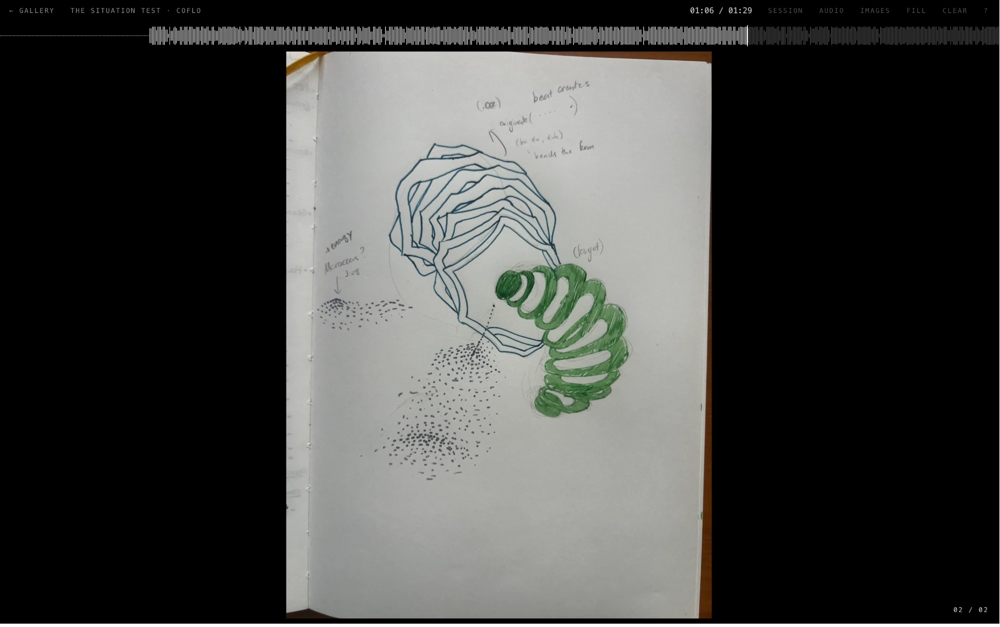

# audiovisual-codebook-ideas

### Main visualizer · logging format exploration



*Placeholder test: "The Situation" by Coflo, 2026-10-30. The visualizer page (`visualizer.html`) shows a session's waveform across the top and its sketch filling the screen.*

A public journal of what I see when I hear music: color, motion, texture and energy, and how they change over the length of a track.

Paper sketches come first. This repo adds **time**. While a song plays, I mark *when* something shifts and how much energy I feel. Later I fill in what I saw and attach photos of my sketches, so each listen can be replayed as a timeline.

> Work in progress.

---

## Todo

- claude language output, garage cleanup
- design system research and clean up - unify tagging/listening
- touch interface design and gesture constraints/ intuitive tagging system
- sound wave visualization clean up (find library)
- audio input playback synchronization

## What's here

| Page | What it's for |
|---|---|
| **Gallery** · `index.html` | The front page: every saved session as a card with a small score. |
| **Session** · `session.html` | One listen, for looking back: the full score, sketches along the timeline, every mark's details, reflection. |
| **Marker** · `mark.html` | Use while listening. Full-screen and black. The space bar marks moments, a trackpad swipe sets energy. |
| **Editor** · `edit.html` | Use afterwards. Fill in each mark (tags, colors, motion, texture, notes), attach sketch photos, save the session. |
| **Visualizer** · `visualizer.html` | Concept draft: an image fills the screen under a slim full-width waveform. **Session** loads a saved listen (its waveform and sketches, no audio needed); **Audio** plays a local file instead. Will grow into visuals forming as the song plays. |
| **Design system** · `docs/design-system.html` | The visual rules every page follows. |
| **Concept** · [`docs/concept.md`](docs/concept.md) | The thinking behind it: vocabulary, data format, decisions. |

## What you need

- A Mac with a trackpad. Other computers work, but the controls are designed for a trackpad.
- **Google Chrome** (recommended). It's the only browser that can save straight into this folder and capture system audio. Safari and Firefox work, but saving downloads files that you move by hand.
- **Python 3**, to run a small local web server. It comes with macOS. If Terminal asks to install developer tools the first time, say yes.

## Run it

**1. Get the code** (first time only)

```bash
git clone https://github.com/mishkin101/audiovisual-codebook-ideas.git
```

**2. Start the local server** from the project folder

```bash
cd audiovisual-codebook-ideas && python3 -m http.server 8765
```

Leave this Terminal window open while you use the journal. Press `Ctrl+C` to stop it.

**3. Open the pages in Chrome**

- Gallery: http://localhost:8765/
- Marker: http://localhost:8765/mark.html
- Editor: http://localhost:8765/edit.html
- Visualizer (concept): http://localhost:8765/visualizer.html

> Opening the `.html` files on GitHub only shows their code. They have to be opened through the local server.

---

## 1 · Listen with the Marker

**Choose where the sound comes from** (bottom left). The waveform at the top is drawn from it.

| Button | Use it for | How |
|---|---|---|
| **File** | A song saved on your computer | Pick an audio file. The whole waveform appears and the Marker plays the song itself. |
| **System** | Spotify Web Player, or any browser tab | Chrome asks what to share. Pick the tab that's playing and turn on **Share tab audio**. The waveform draws live. |
| **Input** | A microphone or audio input | Allow microphone access and pick the input. It hears your speakers, not headphones. To capture the Spotify desktop app, route it through a free loopback driver such as BlackHole. |

The small bar next to the buttons is a level meter. If it moves, the page can hear the music. If you choose no source, marks and energy still work without a waveform.

**Then listen:**

1. Optionally type the title, artist and your mood before. Click **Private** to keep this session off the public repo.
2. Press **Enter** at the same moment the song starts.
3. Mark what you see, and sketch on paper. Write each mark's number (01, 02…) next to the drawing.
4. To play the song again in the same session, press **S** to stop, then **Enter** for a new pass.

| Control | Does |
|---|---|
| **Space**, tap | Instant mark |
| **Space**, hold | Range mark: starts on press, ends on release |
| **Two-finger swipe** | Energy, continuous from 0.00 to 1.00 |
| **Pinch** · **+** **−** **0** | Zoom the timeline in, out, or back to the whole song |
| **Enter** | Start a pass (or a new pass) |
| **S** | Stop the pass |
| **↑ ↓** | Nudge energy |
| **E** | Export the session, named after its title (in Chrome a save dialog lets you rename it and choose the folder) |
| **F** | Choose an audio file as the source |
| **P** | Private on / off |
| **?** | Show all keys |
| **,** | Settings |
| **T** | Input test: shows what the browser receives from the keys and trackpad |
| **I** | Flip the swipe direction |
| **Esc** | Close the panel · show the cursor again (click the score to hide it) |

Forgot a key? Press **?**, or click **? Keys** in the bottom-right corner.

**Change any key:** in the Keys panel, click a key and press the new one (Esc cancels). If that key was already in use, the two actions swap keys. **Restore default keys** puts everything back. The table above shows the defaults; your own keys are saved in your browser and shown in the panel, the hint and the corner button.

**Settings** (press **,**) are saved in your browser: swipe direction and sensitivity, how long space must be held before a tap becomes a range, starting energy, whether the cursor hides during a pass, and whether the header and footer fade.

Everything saves in the browser as you go. A reload won't lose your marks.

## 2 · Fill it in with the Editor

1. Open the Editor and click **From marker**. Your latest listen appears on the same score.
2. Click a mark, or step through marks with **← →**. Fill in its panel on the left:
   - **Tap / Range**: change the kind of mark
   - **Time** and **Energy**: type exact values, or drag a range's edges on the score
   - **Tags**: type and press Enter. Dashed chips suggest tags you've used before.
   - **Colors**: **+** opens a color picker. Your colors are the only color shown anywhere in the interface.
   - **Motion**, **Texture**, **Other** (anything that doesn't fit a field), **Note**
   - **Sketch**: click a photo to pin it to this mark
3. In the right panel, add mood after, place and a reflection. **Add photos** of your paper sketches; iPhone HEIC photos need exporting as JPEG first.
4. Click **Folder** once and choose this project folder. Then **Save** (or `⌘S`) writes:

```
sessions/<date-artist-track>/session.json
sessions/<date-artist-track>/sketch-01.jpg …
```

Private sessions are saved to `private/` instead, which git never uploads.

Saving also updates `sessions/index.json`, the list the gallery reads. Private sessions get their own `private/index.json`, so they show in the gallery on your computer (marked **Private**) but never online.

| Control | Does |
|---|---|
| **Click** a mark | Select it |
| **Double-click** the marks lane | Add a mark there |
| **Drag** a mark or range edge | Change its timing |
| **Pinch**, **swipe** · **+** **−** **0** | Zoom, move along the timeline, fit |
| **← →** | Previous / next mark |
| **⌫** | Delete the selected mark |
| **Z** (or `⌘Z`) | Undo |
| **Audio** button, then **Space** / **N** | Optional: load the track to play/pause, add a mark at the playhead |

Your edits also save in the browser as a draft until you save to the folder.

## 3 · Look back and publish

Open the **Gallery** and click a session to see its page:
- **The score:** pinch or **+ − 0** to zoom; click a mark to jump to its details; **← →** step through marks.
- **Sketches:** the strip under the score places each pinned sketch at its mark's time.
- **Marks table, reflection, and all sketches** large, below.

The repo is public, so anything you commit can be seen.

```bash
git add sessions && git commit -m "Add session" && git push
```

**Put it online with GitHub Pages** (one time): on GitHub open the repo's **Settings → Pages**, set **Source** to *Deploy from a branch*, choose **main** and **/ (root)**, then **Save**. After a minute the gallery is live at `https://mishkin101.github.io/audiovisual-codebook-ideas/`. Every push updates it, and the Marker and Editor work from that address too, with no server needed.

---

## Project layout

```
index.html            Gallery: every saved session
session.html          One session, for looking back
visualizer.html       Concept draft: full-screen image under a full-width waveform
mark.html             Marker: listen and mark
edit.html             Editor: fill in, attach sketches, save
assets/style.css      Design tokens (black, greys, type, spacing)
assets/score.js       Draws the waveform / marks / energy score, shared by every page
assets/journal.js     Shared helpers (time formatting, storage)
sessions/             Saved public sessions, one folder each, plus index.json for the gallery
private/              Saved private sessions (ignored by git)
docs/concept.md       Concept, data format and decisions
docs/design-system.html  Visual rules
prompts/              Early notes and prompts
```

## Troubleshooting

- **A page still looks or behaves like an older version.** Your browser kept old files. Press `⌘⇧R` to reload fresh.
- **The page is blank or says "can't be reached".** The server isn't running. Repeat step 2 and keep that window open.
- **The level meter doesn't move.** With **System**, make sure **Share tab audio** was on. With **Input**, check that the right input is selected and that you're not on headphones.
- **Swiping moves energy the wrong way, or too much or too little.** Press **I** to flip it, or **,** to change sensitivity.
- **The Editor's Save downloads files instead.** You're not in Chrome, or you didn't choose the folder. Click **Folder** in Chrome, or move the downloaded files into `sessions/<date-artist-track>/` yourself.
- **A photo won't add.** It's probably HEIC (iPhone). Export it as JPEG and try again.
- **A saved session doesn't appear in the gallery.** The gallery reads `sessions/index.json`, which the Editor writes when it saves or when you connect the folder. Open the Editor in Chrome with the folder connected, and the list refreshes.

---

